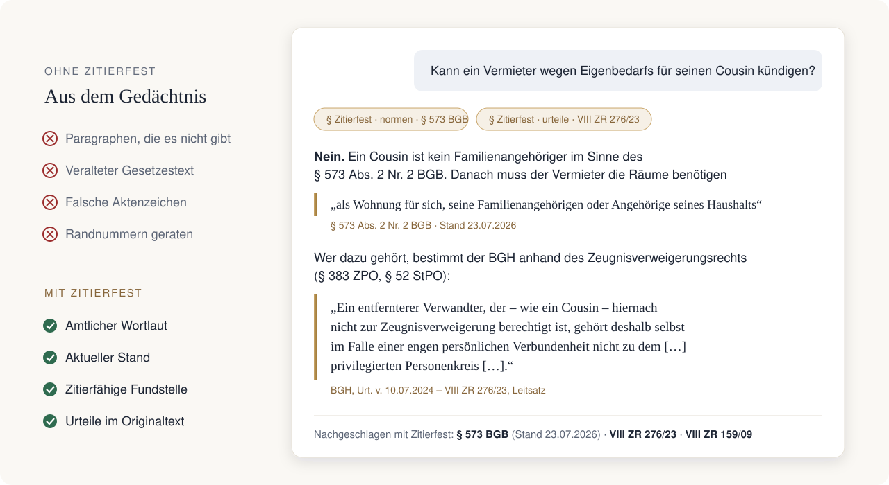

<p align="center">
  <a href="https://zitierfest.de"></a>
</p>

<p align="center">
  <a href="https://zitierfest.de"></a>
  <a href="https://registry.modelcontextprotocol.io/v0.1/servers?search=de.zitierfest"></a>
  <a href="https://glama.ai/mcp/connectors/de.zitierfest/zitierfest"></a>
  
  
</p>

<h3 align="center">Ihre KI zitiert das Gesetz – nicht ihre Erinnerung daran.</h3>

<p align="center">
  Zitierfest verbindet Claude, ChatGPT und andere KI-Assistenten mit dem amtlichen Wortlaut<br>
  deutscher Gesetze und Gerichtsentscheidungen. Mit Fundstelle, Stand und Randnummer.
</p>

<p align="center">
  <a href="#in-30-sekunden-verbunden"><b>Jetzt verbinden</b></a> ·
  <a href="#was-drin-ist">Was drin ist</a> ·
  <a href="#beispiele">Beispiele</a> ·
  <a href="https://zitierfest.de/anleitung">Anleitung</a> ·
  <a href="#english">English</a>
</p>

<br>

<p align="center">
  
</p>

## Warum

Sprachmodelle kennen Gesetze nur aus dem Training. Das Ergebnis: Paragraphen, die es nicht gibt,
veraltete Gesetzestexte, falsche Aktenzeichen und geratene Randnummern. Für Schriftsätze, Gutachten
und Klausuren ist das unbrauchbar.

Mit Zitierfest schlägt die KI nach, bevor sie antwortet: den Paragraphen im amtlichen Wortlaut, die
einschlägigen Urteile mit Randnummer, den Stand der Fassung. Jede Aussage lässt sich auf die Quelle
zurückführen.

## In 30 Sekunden verbunden

Kostenloses Konto auf **[zitierfest.de](https://zitierfest.de)**, dann:

<table>
<tr><td width="200"><b>Claude</b><br><sub>Web, Desktop, Mobile</sub></td><td>

**[Zitierfest im Claude-Verzeichnis](https://claude.ai/directory/zitierfest)** öffnen, auf **Verbinden**
klicken, anmelden, fertig.

Im Chat über das Konnektoren-Menü (Symbol unten im Eingabefeld) „Zitierfest“ einschalten.

<sub>Ohne Verzeichnis: **Einstellungen → Konnektoren → Benutzerdefinierten Konnektor hinzufügen**,
URL `https://mcp.zitierfest.de/mcp`.</sub>

</td></tr>
<tr><td><b>Claude Code</b></td><td>

```bash
claude mcp add --transport http zitierfest https://mcp.zitierfest.de/mcp
```

</td></tr>
<tr><td><b>ChatGPT</b><br><sub>bezahlte Tarife</sub></td><td>

Entwicklermodus einschalten (**Einstellungen → Apps → Erweiterte Einstellungen**), dann eine App
mit der URL oben anlegen. Schritt für Schritt: [Anleitung](https://zitierfest.de/anleitung).

</td></tr>
<tr><td><b>Cursor, VS Code,<br>Gemini CLI u. a.</b></td><td>

```json
{ "mcpServers": { "zitierfest": { "url": "https://mcp.zitierfest.de/mcp" } } }
```

Jeder MCP-Client mit Streamable HTTP und OAuth. Ohne OAuth: API-Schlüssel aus dem Konto als
`Authorization: Bearer …`.

</td></tr>
</table>

> [!TIP]
> Damit die KI Zitierfest auch ungefragt nutzt, schreiben Sie einmal in den Chat:
> *„Merke dir dauerhaft: Bei jeder Frage oder Aussage zu deutschem, EU- oder Völkerrecht nutzt du
> immer zuerst Zitierfest, auch ungefragt, statt Trainingswissen.“*

## Was drin ist

| | Bestand |
| --- | --- |
| **Bundesrecht** | alle Gesetze und Verordnungen von gesetze-im-internet.de |
| **Landesrecht** | alle 16 Länder, Bayern mit Verwaltungsvorschriften |
| **Ortsrecht** | Landeshauptstadt München, Stadt Regensburg |
| **EU-Recht** | Verordnungen, Richtlinien und Verträge in der konsolidierten deutschen Fassung (DSGVO, KI-VO, DSA, AEUV …) |
| **Völkerrecht** | ausgewählte Verträge (EMRK, UN-Kaufrecht …) |
| **Berufsrecht** | BORA, FAO |
| **Rechtsprechung** | BGH ab 2000 · BAG, BVerwG, BFH, BSG, BPatG ab 2010 · BVerfG (Senate ab 1998) · EuGH ab 1954 · EuG ab 1989 · bayerische Obergerichte ab 2021 |
| **Gebühren** | RVG bis zur fertigen Kostennote, GKG, FamGKG, GNotKG, JVEG |

**30.000+ Gesetze und Verordnungen, 530.000+ Einzelnormen, 150.000+ Entscheidungen.** Jede Nacht
mit den amtlichen Quellen abgeglichen; jede Antwort nennt den Stand.

## Beispiele

> *„Kann ein Vermieter wegen Eigenbedarfs für seinen Cousin kündigen?“*

> *„Fundstellen für den Schriftsatz: Unwirksamkeit von Schönheitsreparaturklauseln bei unrenoviert
> übergebener Wohnung, aktuelle BGH-Rechtsprechung mit Randnummern.“*

> *„Prüfe alle Normzitate in diesem Entwurf auf den aktuellen Fassungsstand.“*

> *„Urteil zugestellt am 03.11. – wann enden Berufungs- und Berufungsbegründungsfrist?“*

> *„Abstandsflächen nach Art. 6 BayBO: Welche Tiefe gilt im Gewerbegebiet?“*

> *„Kostennote bei 12.500 € Streitwert, 1,3 Verfahrens- und 1,2 Terminsgebühr.“*

## Werkzeuge

Neun Werkzeuge, alle nur lesend. Die KI wählt selbst, welches sie braucht.

| Werkzeug | Wofür |
| --- | --- |
| `normen` | Paragraphen und Artikel im Wortlaut, einzeln, mehrere oder als Bereich, auch einzelne Absätze mit Satznummern |
| `urteile` | Entscheidungen nach Thema, Norm oder Aktenzeichen; Gründe mit Randnummern, zitierfertige Zitatzeile |
| `suche` | Volltextsuche über alle Gesetze mit Ranking, Rechtsgebiet und Rechtsraum |
| `gesetze_finden` | Gesetz nach Kürzel, Titel, Land oder Kommune finden |
| `gesetz` | Gliederung, Änderungen und Lücken eines Gesetzes |
| `verweise` | Welche Normen eine Vorschrift zitieren und welche sie selbst zitiert |
| `stand` | Aktualität je Gesetz und Quelle |
| `gebuehr_berechnen` | RVG, GKG, FamGKG, GNotKG, Kostennote |
| `gebuehren_verzeichnis` | VV RVG, KV GKG/FamGKG/GNotKG, JVEG |

## Datenschutz

- Server in Deutschland (Nürnberg).
- Zitierfest erhält nur die konkrete Abfrage (etwa „§ 573 BGB“), nie den Chat.
- Amtliche Texte sind gemeinfrei (§ 5 UrhG); Zitierfest bietet keine Rechtsberatung.

Details: [Datenschutz](https://zitierfest.de/datenschutz) · [Nutzungsbedingungen](https://zitierfest.de/nutzungsbedingungen) · [Impressum](https://zitierfest.de/impressum)

## Feedback

Fehler im Wortlaut, fehlende Gesetze oder Gerichte, Ideen: [Issue anlegen](../../issues/new) oder
[kontakt@zitierfest.de](mailto:kontakt@zitierfest.de).

---

## English

**Zitierfest gives AI assistants the official wording of German law** — so answers quote the
statute instead of paraphrasing from memory.

- **Statutes:** federal law, all 16 German states, municipal law (Munich, Regensburg), EU law in
  German, selected treaties, German bar rules — 30,000+ acts, 530,000+ provisions
- **Case law:** German federal courts and the CJEU — 150,000+ decisions, citable with date, docket
  number and paragraph number
- **Legal fees:** RVG, GKG, FamGKG, GNotKG, JVEG, up to a complete fee note
- Nine read-only tools, synced nightly with the official sources, every answer states the version
  date. Hosted in Germany. Free account with 500 requests per day.

**Connect:** `https://mcp.zitierfest.de/mcp` (Streamable HTTP, OAuth 2.1; API keys for clients
without OAuth). Claude Code:

```bash
claude mcp add --transport http zitierfest https://mcp.zitierfest.de/mcp
```

Tools, results and statutes are in German; the assistant can answer in English and quote the
German text. Not legal advice.

<br>

<p align="center">
  <sub>Zitierfest · <a href="https://zitierfest.de">zitierfest.de</a> · Dokumentation unter <a href="LICENSE">CC BY 4.0</a></sub>
</p>
